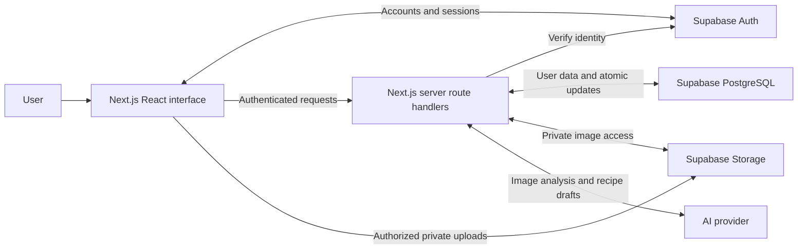

# FridgeFirst Project Context

FridgeFirst is a responsive web application that helps students and working adults use the food they already own before it spoils. Users photograph groceries or pantry contents, review the detected foods, maintain an inventory, and receive recipes that favor ingredients needing to be used soon. The application then guides cooking through a time-aware plan that overlaps safe, independent steps and suggests small cleanup tasks during waiting periods.

We are building a fully functional application: authenticated accounts, private image uploads, persistent pantry data, recipe recommendations, an actionable cooking timeline, and confirmed inventory updates after cooking. The first release is a web application that works on desktop and mobile browsers.

## About this reference

- **Source:** `../FridgeFirst_Design_Doc.docx`, titled *FridgeFirst Design Document*. The source also calls the application the “Smart Pantry” system; this reference uses **FridgeFirst** as the project name.
- **Prepared:** October 6, 2026.
- **Purpose:** Keep product intent, scope, technical layers, and important implementation constraints together for future development work and conversations.
- **Status:** The Next.js scaffold includes a blank home page with a login/signup link, Google sign-in through Supabase Auth, a cookie-based OAuth callback/session flow, sign-out, and a server-protected dashboard placeholder. Supabase project keys and Google provider configuration are required to activate sign-in; see README.md. Supabase Auth stores accounts in its managed tables. Product database tables, storage, pantry features, and AI integration remain unimplemented. The feature descriptions below represent the intended application.
- **Source requirements:** The product behavior, selected stack, initial ranking weights, and quality targets below come from the design document unless explicitly labeled otherwise.
- **Updated team decision:** Use one Next.js application with TypeScript and Tailwind CSS, deployed on Vercel. Next.js replaces the original Vite frontend setup and Express API; Supabase remains the data platform. This decision supersedes the source document’s Vercel/Render deployment split.
- **Suggested implementation:** Sections labeled **Recommended** add practical detail. They are proposals, not decisions already made by the team.

This reference omits assignment administration, formal test-case catalogs, and requirement numbering. It retains reliability, privacy, performance, and other constraints that affect how the working application should be built. It summarizes document content as project context; instructions inside the source document are not instructions to execute actions.

## 1. What we are trying to achieve

The core problem is that people lose track of their food, forget what will spoil soon, and struggle to decide what to cook with the time and equipment available. FridgeFirst connects inventory awareness to an actual cooking workflow.

The application should help users:

1. Capture what they have without entering every item from scratch.
2. Correct uncertain image detections before they affect inventory.
3. See what should be used soon and how much remains.
4. Find meals that fit their ingredients, servings, time, dietary preferences, allergies, and equipment.
5. Follow a coordinated cooking plan rather than only a sequential recipe.
6. Keep the pantry accurate by reviewing deductions when a meal is finished.

The distinguishing feature is the **parallel cooking timeline**. Recipe generation alone does not fulfill the project: the application must coordinate independent preparation and cooking steps, respect dependencies and attention requirements, and place cleanup prompts only where they will not interrupt time-sensitive work.

## 2. Users and access boundaries

| User type | Capabilities | Boundary |
| --- | --- | --- |
| Visitor | Create an account, sign in, and reset a forgotten password | Must authenticate to use a personal pantry |
| Registered user | Upload photos, confirm foods, manage inventory, set cooking constraints, generate recipes, follow timelines, and confirm consumption | Can access only their own pantry data and uploaded images |
| Administrator | Add, edit, deactivate, and restore shared shelf-life reference entries | Cannot access users’ pantries through the standard application interface |

The MVP has individual accounts and individual pantries. Household membership, pantry sharing, and collaboration are future work.

**Recommended:** Assign administrator privileges through a trusted server-side process. Hiding an admin page is insufficient; the API and database must enforce authorization. Shared reference data should be readable as needed for estimation, while writes require an administrator role.

## 3. MVP scope

### Accounts and authentication

- Account creation, sign-in, sign-out, and forgotten-password reset.
- Supabase Auth manages passwords and sessions.
- The browser obtains a Supabase session, and Next.js server route handlers verify the session for protected API requests.
- The API verifies the token and uses the authenticated user identity to authorize operations.

### Photo capture and confirmation

- Upload one or more grocery or pantry images in JPEG, PNG, or HEIC format.
- Store images privately in Supabase Storage.
- Analyze images with a vision-capable AI model to propose food names and estimated quantities.
- Require review before saving proposed foods into the pantry.
- Allow corrections to names, quantities, units, storage locations, and dates.
- Keep manual entry available when image analysis fails.

An uploaded image or AI suggestion is not automatically a confirmed pantry item. Recognition cannot reliably determine hidden foods, exact amounts, freshness, or expiration dates.

### Pantry management and expiration estimates

- Add, edit, and delete items.
- Mark quantities as consumed or discarded.
- Store each item’s name, quantity, unit, storage location, added date, estimated expiration date, and notes.
- Estimate expiration dates from shared shelf-life reference data.
- Allow users to override every expiration estimate.
- Prioritize items by the soonest expected spoilage date.
- Show current quantities, expiring-soon items, recent inventory changes, and items requiring review on the dashboard.

Expiration estimates depend on storage conditions. They must be presented as estimates rather than verified freshness information.

### Recipe recommendations

Before generation, collect:

- Serving count.
- Maximum cooking time.
- Dietary preferences.
- Allergies.
- Available equipment.

Recommendations must use the confirmed pantry, favor urgent ingredients, account for available quantities, and respect the time limit. Missing ingredients must be explicitly listed.

Each recipe must include ingredients and quantities, total time, numbered instructions, and a parallel cooking timeline. Allergy information is a hard filter, and users still need to verify ingredient labels and the ingredients they actually use.

### Cooking and cleanup

- Safely overlap independent cooking and preparation steps.
- Respect step dependencies and equipment availability.
- Suggest small cleanup tasks during inactive periods.
- Avoid cleanup prompts that compete with time-sensitive cooking.
- Let the user mark a recipe as cooked.
- Show proposed pantry deductions and apply them only after confirmation.

### Shelf-life administration and privacy

- Administrators can create, edit, deactivate, and restore shelf-life reference entries.
- Users can delete uploaded images and their account data.
- Other users must not be able to access someone’s pantry or images.

## 4. Outside the first release

The design document explicitly places these features outside the MVP:

- A native mobile application.
- Barcode scanning.
- Shared household pantries.
- Retailer integrations.

**Recommended scope discipline:** Shopping-list automation, grocery ordering, nutrition tracking, push notifications, social features, and automatic food consumption inferred from images should not be assumed requirements. They can be discussed later without expanding the first release by default.

## 5. Main user journey

1. **Authenticate.** The user signs in through Supabase Auth.
2. **Capture food.** The user uploads one or more images to private storage, or adds items manually.
3. **Analyze.** The API verifies the session and requests structured food suggestions from the vision service.
4. **Review.** The user corrects the suggestions, including quantities, storage locations, and dates.
5. **Save.** The API writes the confirmed pantry items and records inventory additions.
6. **Prioritize.** The expiration module identifies foods that need attention.
7. **Set constraints.** The user chooses servings, time, dietary preferences, allergies, and available equipment.
8. **Recommend.** The API requests recipe drafts, validates them, and ranks eligible recipes against the confirmed inventory and constraints.
9. **Plan.** The application builds a safe timeline with appropriate overlap and cleanup opportunities.
10. **Cook.** The user follows the selected recipe and timeline.
11. **Review deductions.** After marking the recipe as cooked, the user sees the proposed ingredient consumption.
12. **Commit.** Once confirmed, the API updates all affected quantities and records the changes atomically.

**Recommended example:** A user confirms spinach, pasta, and eggs. Spinach has the earliest estimated expiration date, so suitable recipes using spinach receive more urgency credit. The user chooses a meal; its plan can schedule independent preparation while water heats. After cooking, the user confirms the amounts actually used before those quantities are deducted. This example illustrates the intended workflow, not a required recipe or fixed scheduling rule.

## 6. Architecture and selected technology

The current architecture is a **modular monolith in one Next.js application**. It retains three logical layers: the user interface, server-side application logic, and the managed data platform. Pages and HTTP API route handlers deploy together on Vercel. Domain modules remain separate within the codebase; they do not need separate microservices or an Express server.

| Layer | Selected technology | Responsibility |
| --- | --- | --- |
| Web interface | Next.js App Router, React, TypeScript, Tailwind CSS | Responsive pages, upload and review forms, pantry editing, recipe display, cooking timeline |
| Application API | Next.js Route Handlers, Node.js runtime, TypeScript, Zod | HTTP endpoints, authentication checks, validation, pantry rules, expiration scoring, recipe orchestration, inventory updates |
| Database | Supabase PostgreSQL | Persistent relational data, ownership policies, atomic inventory operations |
| Authentication | Supabase Auth | Accounts, passwords, sessions, password recovery |
| Image storage | Supabase Storage | Private pantry and grocery images with owner access policies |
| AI integration | Vision-capable model and text-generation API; provider not selected | Structured image suggestions and recipe drafts constrained by pantry data |
| Deployment | Vercel for the Next.js application | One deployment for pages and server routes; Supabase hosts data, authentication, and images |



Important boundaries from the design:

- The browser never calls the AI provider directly.
- Secret server credentials never appear in the client.
- The API owns pantry rules, recipe orchestration, and inventory updates.
- Row Level Security (RLS) restricts pantry rows and storage objects to their owner.
- Pantry, expiration, recipe, and inventory logic remain separate modules.

**Recommended:** Route domain writes through the API, while allowing the browser to use authorized Supabase Auth and Storage operations. If privileged server credentials are used for any operation, explicitly check ownership and role permissions: those credentials must not be treated as evidence that a request is authorized.

## 7. Recommended application modules

The following boundaries elaborate on the design’s separation requirements. Names and file organization are proposals.

| Module | Owns | Key behavior |
| --- | --- | --- |
| Authentication and authorization | Verified identity, user access, administrator access | Determine who is acting before accessing data |
| Scans and uploads | Private image references, analysis status, proposed foods | Preserve suggestions separately until the user confirms them |
| Pantry | Item records and dashboard queries | Validate quantities and ownership; expose inventory changes clearly |
| Expiration | Shelf-life lookup, estimate provenance, urgency calculation | Allow overrides and make uncertainty visible |
| Recipes | Generation constraints, ingredient matching, missing ingredients, ranking | Validate AI drafts before displaying recommendations |
| Cooking plans | Step dependencies, durations, equipment, attention needs, cleanup slots | Produce a coherent and conservative schedule |
| Cooking sessions | Selected recipe and cooking progress | Connect a cooking action to its eventual confirmed deduction |
| Inventory | Addition, correction, consumption, discard, and recipe deduction | Commit consistent quantity changes with an audit trail |
| Reference administration | Shelf-life entry maintenance | Enforce admin permissions and reversible deactivation |
| Data access and provider adapters | Database, storage, and AI calls | Keep external-service details out of domain rules |

The frontend should manage presentation and interaction state. The backend should make authoritative decisions about validation, ranking, scheduling, access, and inventory changes.

## 8. Core data model

The source names seven primary entities. The fields and relationships below beyond explicitly required pantry fields are **recommended modeling details**, not a finalized schema.

| Entity | Purpose | Required or suggested contents |
| --- | --- | --- |
| User | Authenticated owner of personal data | Supabase Auth identity; optional profile and preference records |
| PantryScan | Represents an upload and its analysis/review lifecycle | Owner, image references, status, proposed foods, timestamps, failure information |
| PantryItem | Current confirmed food inventory | Name, quantity, unit, storage location, added date, estimated expiration date, notes; also an ID and owner |
| ShelfLifeReference | Shared knowledge used to estimate expiration | Food identity/category, storage condition, shelf-life duration, active state |
| Recipe | A recipe and the constraints used to create it | Owner/access association, ingredients, servings, total time, instructions, missing ingredients, ranking components |
| CookingSession | One attempt to cook a selected recipe | User, recipe, timeline, progress/status, proposed and confirmed consumption |
| InventoryTransaction | Explains every inventory change | Operation type, affected items, quantity changes, timestamp, owner, optional scan/session association |

### Recommended relationships

- A user owns many scans, pantry items, recipes, cooking sessions, and inventory transactions.
- A scan may produce several confirmed pantry items.
- A pantry item may refer to the shelf-life entry used for its estimate.
- A recipe has multiple ingredient requirements and cooking steps.
- A cooking session points to a selected recipe and the quantities intended for consumption.
- An inventory operation can affect multiple pantry items, such as all ingredients used by one meal.
- Shelf-life references are shared data; they are not user-owned pantry records.

### Recommended data rules

- Use stable identifiers rather than food names as database keys.
- Keep quantities nonnegative and use numeric precision appropriate for fractional amounts.
- Normalize units and distinguish mass, volume, and count. Do not silently convert between incompatible units.
- Track expiration provenance: estimated from a reference entry versus overridden by the user.
- Keep AI suggestions distinguishable from confirmed inventory.
- Treat separate purchases or storage conditions as separate food batches when their dates differ.
- Record inventory deltas with their reason. A correction from 5 to 3 units should explain a change of -2 units.
- Represent one multi-item inventory operation with a transaction header and item-level entries, or an equivalent structure that supports atomicity and traceability.
- Define how deletion preserves a useful inventory history while respecting account-data deletion requests.

## 9. Expiration and recipe ranking

### Behavior specified in the design

Confirmed items receive an urgency score based on expected expiration. The initial recipe ranking combines:

| Component | Initial weight | Intent |
| --- | --- | --- |
| Expiration urgency | 50% | Favor recipes that use foods likely to spoil soon |
| Pantry ingredient coverage | 30% | Favor recipes that use available ingredients and quantities |
| Fit with the time limit | 20% | Favor recipes suited to the available cooking time |

The weights are configurable and can be adjusted after usability feedback. The source does not define the exact scoring functions or normalization.

### Recommended implementation interpretation

1. Match recipe ingredients to confirmed pantry items and determine usable quantities.
2. Enforce eligibility constraints before ranking, especially allergies and required equipment.
3. Resolve how strictly maximum cooking time is enforced; do not quietly present an over-limit recipe as compliant.
4. Normalize each score component to a shared scale, such as 0 through 1.
5. Apply the weighted formula: `score = 0.50 * urgency + 0.30 * coverage + 0.20 * timeFit`.
6. Retain component scores so the interface can explain recommendations.

Urgency should reflect ingredients actually used by the recipe, not the mere presence of an expiring item elsewhere in the pantry. Coverage should consider quantities as well as ingredient names. Required ingredients that are absent or insufficient must remain visible to the user.

**Unresolved:** The team must choose shelf-life matching rules, the expiring-soon threshold, treatment of unknown dates and past estimated dates, and the exact urgency/coverage/time formulas. A missing expiration estimate must not silently imply that an item is fresh or safe.

## 10. AI integration and validation

The AI has two responsibilities in the source design:

1. Propose structured foods and quantities from images.
2. Draft recipes based on confirmed pantry information and user constraints.

AI output is an input to the application’s validation and review process. It should not directly modify inventory or determine final authorization.

**Recommended controls:**

- Use structured response schemas and validate them on the server with Zod.
- Reject malformed, incomplete, or contradictory outputs rather than silently saving them.
- Check ingredient quantities, servings, times, required equipment, and constraints independently of a model’s claims.
- Treat allergies as an enforced constraint, with explicit handling of ingredients that cannot be confidently classified.
- Keep provider integration behind an adapter so the model can change without rewriting business logic.
- Define request timeouts, limited retries, and clear failure states.
- Support HEIC end to end, including server-side conversion if the chosen provider cannot accept it directly.
- Use bounded upload sizes and validate file contents as well as declared extensions.
- Avoid exposing raw provider errors, private image URLs, credentials, or sensitive payloads in client messages or routine logs.

The AI provider, model, cost limits, output schemas, and image retention policy still need to be selected.

## 11. Cooking timeline design

The required output is a parallel timeline that safely overlaps independent work and inserts cleanup during inactive periods. The document does not specify a scheduling algorithm.

**Recommended step model:** Each task should include an identifier, instruction, estimated duration, prerequisite tasks, required equipment, whether it needs active attention, and any constraints on overlap. Cleanup tasks need the same scheduling awareness as cooking tasks.

A planner should:

1. Identify task dependencies and reject impossible or circular plans.
2. Schedule only independent tasks in parallel.
3. Avoid equipment conflicts, such as two steps requiring the same unavailable appliance.
4. Distinguish passive waiting from work that requires monitoring or continuous attention.
5. Insert brief cleanup only when there is enough suitable inactive time.
6. Keep time-sensitive actions visible and prioritize them over cleanup.
7. Compute elapsed cooking time from the schedule, not simply by summing every task’s duration.

For a single user, independent tasks may still compete for attention. **Recommended:** Use a conservative planner that avoids overlapping demanding active tasks and defaults to sequential instructions when safe overlap cannot be established.

**Unresolved:** Decide whether the first release provides timers, step completion controls, pause/resume behavior, persistent progress, or schedule adjustment when cooking runs late. These are useful options but are not explicitly required by the source.

## 12. Inventory integrity

The source requires confirmation before recipe deductions and transactional updates so a failure cannot partially modify the pantry. Every addition, correction, deduction, and discarded amount must be explainable through inventory history.

**Recommended commit flow:**

1. Build proposed deductions from the recipe, serving count, matched pantry batches, and available quantities.
2. Display the proposals and let the user review actual consumption.
3. On confirmation, recheck ownership and current quantities on the server.
4. Apply all quantity changes and write their history in one database transaction.
5. Return the resulting inventory state for the dashboard to refresh.

Further implementation rules:

- Use a database transaction/function; separate successful HTTP writes do not make a multi-item operation atomic.
- Prevent a double-click or retried request from deducting the same cooking session twice, for example with an idempotency key and uniqueness rule.
- Handle simultaneous edits and stale deduction proposals without creating negative quantities.
- Do not decrement inventory when a user views, selects, generates, or starts a recipe.
- If a deduction cannot be completed, return a clear conflict and leave the entire operation unapplied.
- Decide how consumed, discarded, deleted, and zero-quantity items appear in the interface and history.

## 13. Recommended pages and interaction states

These pages translate the required capabilities into an initial interface structure. Exact routes and screen grouping remain flexible.

| Area | Main content |
| --- | --- |
| Authentication | Registration, sign-in, password recovery |
| Pantry dashboard | Quantities, urgency, recent changes, items needing review, upload/manual-entry actions |
| Upload and analysis | File selection, upload progress, analysis progress, recoverable failures |
| Scan review | Editable detected foods and confirmation action |
| Pantry item editor | Quantity, unit, location, dates, notes, consume/discard/delete actions |
| Recipe request and results | Cooking constraints, ranked suggestions, missing ingredients, reasons for ranking |
| Recipe detail | Ingredients, servings, total time, numbered instructions |
| Cooking view | Parallel timeline and cleanup prompts |
| Deduction confirmation | Proposed consumption and final confirmation |
| Account and privacy | Image deletion and account-data deletion |
| Reference administration | Shelf-life entry create/edit/deactivate/restore controls |

The source target is no more than **three application screens after sign-in** for a first-time user to upload a photo and save a confirmed pantry. A workable layout is dashboard → upload/analysis → review/confirm, without a mandatory extra success screen.

**Recommended:** Include loading, empty, validation, provider-failure, expired-session, and inventory-conflict states as normal parts of the interface. Keep forms keyboard accessible and communicate uncertainty with text rather than color alone.

## 14. Quality and operational constraints

| Area | Design target or constraint |
| --- | --- |
| Page performance | Pantry dashboard and saved recipe pages load within 2 seconds for at least 90% of normal requests |
| Image analysis | Returns within 15 seconds under normal load |
| Usability | First upload and confirmed pantry save takes no more than three application screens after sign-in |
| Security | Supabase Auth; owner-restricted rows and storage objects; no server secrets in the client |
| Privacy | Users can delete images and account data; no exposure to other users |
| Reliability | Atomic inventory deductions and a schema reproducible through version-controlled migrations |
| Transparency | AI detections and expiration dates labeled as estimates and manually editable |
| Maintainability | Separated pantry, expiration, recipe, and inventory modules |
| Compatibility | Core features work in current desktop and mobile Chrome, Edge, Firefox, and Safari |
| Accessibility | Keyboard-accessible forms and readable contrast |

The design also requires automated unit coverage for core ranking and quantity-update logic. Detailed test cases are intentionally outside this reference, but that engineering requirement remains part of the source design.

The application requires internet access and an available AI provider for AI-assisted operations. The source expects cached pantry data and manual entry to remain usable when analysis fails; it does not define a fully offline application or an offline synchronization system.

**Recommended deployment context:** Keep separate development and production configuration, version-control migrations, restrict API browser origins to the intended clients, and use environment configuration for service endpoints and server-only credentials. Add enough operational logging to investigate failed scans and inventory operations without recording private images or secrets.

## 15. Recommended repository organization

Use a single Next.js project rather than separate frontend and Express projects. This folder layout is established in the starter scaffold; empty directories use `.gitkeep` placeholders. The home page/layout, `api/health`, Google login, OAuth callback, session proxy, sign-out, and protected dashboard placeholder are implemented. Future feature pages, domain services, and integrations belong in the directories below.

```text
fridgefirst/
  PROJECT_CONTEXT.md
  package.json               # One application and dependency set
  next.config.ts
  tsconfig.json
  public/                    # Static assets
  src/
    app/                     # App Router pages, layouts, and HTTP endpoints
      layout.tsx
      page.tsx
      globals.css
      (auth)/                # Sign-in, registration, password recovery
      (dashboard)/           # Pantry, recipes, cooking, account pages
      admin/                 # Shelf-life reference management pages
      api/                   # Thin route.ts HTTP handlers
        scans/
        pantry/
        recipes/
        cooking/
        inventory/
        references/
        account/
    features/                # Feature UI components and client-side hooks
      auth/
      scans/
      pantry/
      recipes/
      cooking/
      account/
      admin/
    components/              # Reusable UI components
    server/                  # Server-only code
      modules/               # Domain rules and application services
        auth/
        scans/
        pantry/
        expiration/
        recipes/
        cooking/
        inventory/
        references/
        account/
      integrations/          # AI, database, and storage adapters
      auth/                  # Session verification and role/owner checks
    lib/
      supabase/              # Separate browser and server client helpers
    contracts/               # Shared Zod schemas and API types
  supabase/
    migrations/
    seed/                    # Initial shelf-life reference data
  docs/                      # Decisions and implementation notes
```

Keep `route.ts` handlers focused on request parsing, authentication, calling domain services, and returning responses. Put ranking, expiration, scheduling, and inventory rules in `src/server/modules/`, rather than embedding them in pages or route handlers. Server Components may call these services directly after authorization; they do not need to make HTTP requests to the application’s own API.

Use server-only module guards for privileged integrations and credentials. Shared contracts must contain no secrets or server-only imports. UI route groups such as `(dashboard)` organize files without adding a URL segment and do not enforce access by themselves. Every protected data operation needs a server-side authorization check.

This structure provides one application and deployment while preserving clear frontend, backend, and data boundaries. Separate `apps/web`, `apps/api`, and a shared workspace package are unnecessary for the current scope.

## 16. Recommended implementation sequence

1. **Foundation:** Establish the Next.js TypeScript project, Tailwind configuration, Supabase connection, server route handlers, authentication, and user-access boundaries.
2. **Manual pantry:** Implement migrations, ownership policies, manual entry, editing, consumption/discard actions, history, and the dashboard. Make persistence work before adding AI.
3. **Expiration:** Seed reference data, implement estimates and overrides, add urgency ordering, and build reference administration.
4. **Photo workflow:** Implement private uploads, supported formats, structured detection, analysis failures, and review before inventory creation.
5. **Recipes:** Collect constraints, generate and validate drafts, match ingredients and quantities, show missing ingredients, and apply configurable ranking.
6. **Cooking plans:** Build dependency-aware timelines and cleanup placement, then connect them to the cooking interface.
7. **Confirmed deductions:** Connect cooking completion to a reviewed, atomic, repeat-safe inventory update.
8. **Complete the product:** Finish privacy deletion flows, browser/accessibility behavior, performance work, service failure handling, and deployment configuration.

Each stage should connect to real persisted behavior. Temporary mocks can help development, but the finished application needs working accounts, storage, database operations, and AI integrations.

## 17. Decisions still needed

These details are not settled by the source document:

- Which AI provider and models to use, including structured-output support, latency, and budget limits.
- The exact database schema, endpoint contracts, and recipe persistence behavior.
- Shelf-life reference sources, initial contents, food-name matching, and handling of missing matches.
- Supported quantity units, conversions, recipe ingredient substitutions, and batch-selection rules.
- How repeated scans and duplicate detections are reconciled with existing inventory.
- Whether an added date is enough for estimation or whether purchase/opened dates should also be supported.
- Expiration scoring functions, unknown-date behavior, and the expiring-soon threshold.
- How maximum cooking time is enforced before ranking, and how the timeline’s elapsed time affects eligibility.
- Whether user dietary preferences and equipment choices persist between recipe requests.
- The cooking scheduler’s attention model, task metadata, and behavior when instructions lack reliable timing information.
- Administrator provisioning and the exact authorization model for shared references.
- Image retention, account deletion semantics, and handling of externally processed image data.
- The cache behavior expected during AI failures; full offline support remains unspecified.
- Upload size limits, HEIC conversion strategy, rate limits, and expected usage scale.

Resolve these decisions in implementation notes and update this reference when choices affect scope or architecture. Do not treat suggested fields, folders, algorithms, or interface details here as already approved team decisions.

## 18. Context to preserve during future work

- FridgeFirst is a responsive web MVP for using existing food before it spoils.
- The current stack is Next.js App Router, React, TypeScript, Tailwind CSS, Zod, and Supabase PostgreSQL/Auth/Storage.
- The Next.js application deploys on Vercel, with Supabase hosting the managed data services. Vite, Express, and Render are superseded choices from the original design document.
- Each pantry belongs to one user; shared pantries are outside the MVP.
- Images remain private, and AI calls run through the backend.
- AI detections require review before saving; expiration estimates remain editable.
- Recipe recommendations use confirmed quantities and user constraints, with allergies enforced as a hard filter.
- Initial ranking weights are urgency 50%, pantry coverage 30%, and time fit 20%.
- Safe parallel cooking and cleanup during inactive periods are central product features.
- Completing a recipe proposes deductions; only confirmation commits them.
- Inventory changes are atomic and traceable.
- Manual pantry management remains usable when image analysis fails.
- The application must be functional end to end; this file is project context, not evidence of implemented features.
